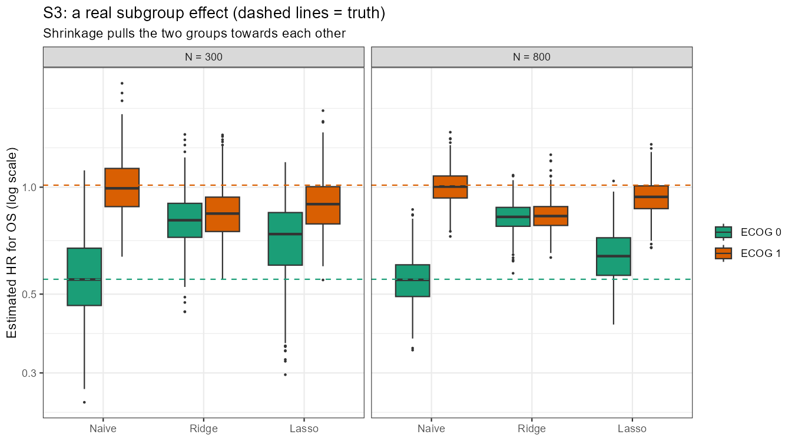
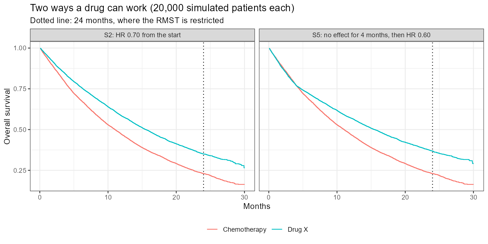
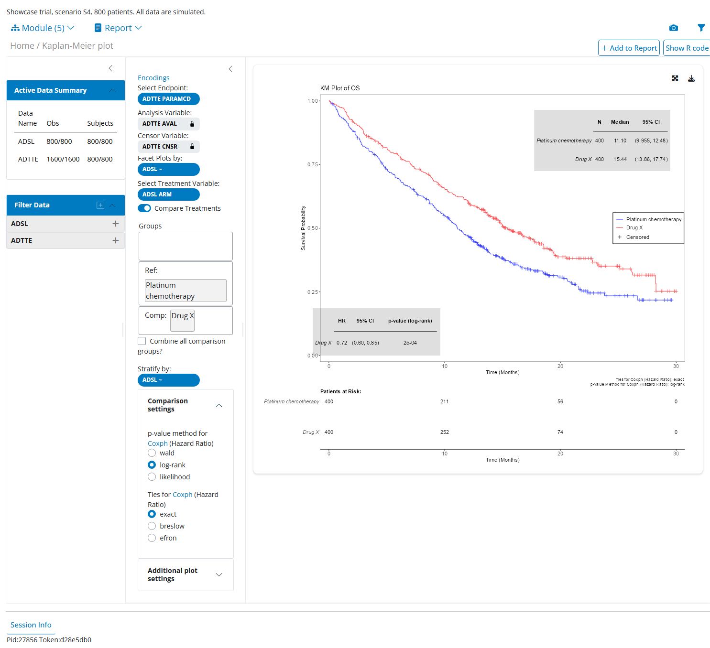
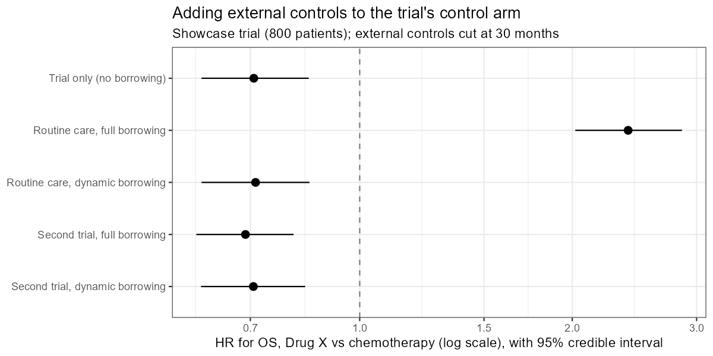

# Right Drug, Right Patient

[](https://github.com/Maryam-Allahyari/right-drug-right-patient/actions/workflows/tests.yaml)

**How far can we trust what a cancer trial tells us?**

This project looks at that question from two sides, using advanced non-small cell lung cancer (NSCLC) as the example:

1. **Inside the trial:** in a first-line NSCLC trial comparing a new drug with platinum chemotherapy, which subgroup findings can you trust? A simulation study built on a CDISC reporting pipeline, using Roche's open-source R tools.
2. **Outside the trial:** the patients who get platinum chemotherapy in routine care. Do they look like that trial's control arm, and how long do they live? A real-world cohort built from synthetic health records in the OMOP Common Data Model.

**Progress:**
- Part 1: done. The plan ([docs/sap.md](docs/sap.md)), code ([trial/](trial/)) and results are below.
- Part 2: done ([omop/](omop/)); results below.

All data are **simulated or synthetic**: there are no real patients and no real drug. The results describe how the methods behave in data like these; they say nothing about the effect of any real treatment.

## How the two parts fit together

| | Part 1: simulated trial | Part 2: real-world cohort |
|---|---|---|
| Patients | first-line advanced NSCLC | NSCLC patients in synthetic health records |
| Treatment compared | Drug X vs **platinum chemotherapy** (cisplatin + paclitaxel) | **platinum chemotherapy** (cisplatin + paclitaxel) |
| Main endpoint | overall survival (OS) | OS (health records have no tumour scans, so no progression) |
| Data standard | CDISC SDTM → ADaM | OMOP CDM → the same ADaM structure (ADSL, ADTTE) |

The trial's control arm and the real-world cohort get the same treatment and end up in the same ADaM format, so one piece of code can describe both: who the patients are (age, sex) and how long they live (Kaplan–Meier curves, OS at 12 and 24 months).

## Part 1: subgroup findings inside the trial

### Why this question
Trials report a forest plot: one treatment effect per subgroup (sex, age, region, biomarker level…). With many subgroups, some will look different by chance alone. Acting on a false subgroup result means giving a drug to patients it doesn't help, or withholding it from patients it does, and biomarker-driven treatment (personalised healthcare) depends on telling real effects from noise. Regulators and methodologists warn against over-reading subgroups (EMA, 2019; Kent et al., 2020). Shrinkage methods, which pull extreme subgroup estimates towards the overall effect, have been proposed as a more reliable alternative (Wolbers et al., 2024).

### Design
In a real trial nobody knows the true effect in each subgroup, so there's no way to check whether a method got it right. Here the trials are simulated, so the truth is known (Morris et al., 2019). The plan was written before the code was run ([docs/sap.md](docs/sap.md), version 2; the changes from version 1 are listed at its end).

- **Trial:** first-line advanced NSCLC, 1:1 Drug X vs cisplatin + paclitaxel, 300 or 800 patients, 30 months of follow-up. The control arm is set up like published platinum-chemotherapy arms (median OS about 11 months; Paz-Ares et al., 2018; Gadgeel et al., 2020).
- **Primary endpoint:** OS. Progression-free survival (PFS) and tumour response are secondary.
- **Subgroups:** sex, age (< 65 / ≥ 65), region, ECOG performance status (Eastern Cooperative Oncology Group), histology (squamous or not) and a biomarker with an assay cut-off: 6 variables, 13 subgroups.
- **Scenarios:** S1 the drug does nothing; S2 the same effect for everyone (hazard ratio, HR 0.70); S3 an effect only in ECOG 0 patients (HR 0.55 vs 1.00); S4 an effect that grows with the biomarker.
- **Methods:** a separate Cox model per subgroup (the standard forest plot), treatment-by-subgroup interaction tests, ridge and lasso shrinkage (`bonsaiforest`), and the biomarker modelled three ways (cut-off, linear on the log scale, spline).
- **Size:** 500 trials per scenario and trial size (4,000 trials). Every result has a Monte Carlo standard error (MCSE) of at most 2.2 percentage points.

### Checking the CDISC pipeline
80 simulated trials (24,000 patients) were written out as SDTM (DM, DS, EX, RS, SC, SS), derived to ADaM (ADSL, ADRS, ADTTE) with `admiral` and `admiralonco`, and compared patient by patient with the OS and PFS known from the simulation. **There were no differences** in survival times or censoring, so the large study works on the analysis data directly ([pipeline_vs_truth.csv](trial/results/pipeline_vs_truth.csv)).

### Key findings
- **When the drug does nothing, a third of trials (33%) still show at least one "significant" subgroup** in the standard forest plot, and 27% show a "significant" interaction. With 800 patients instead of 300 it's the same (32%): the problem is the number of looks, not the trial size.
- **When the drug works equally well for everyone, interaction tests still suggest a difference in 25–29% of trials.**
- **A real subgroup effect is easy to miss and easy to dilute.** When only ECOG 0 patients benefit, the overall result (HR 0.81) is significant in only 30% of trials with 300 patients. The ECOG interaction is found in 47% of trials with 300 patients and 87% with 800, and in about 1 in 5 trials one of the four variables with no real effect is flagged as well.
- **Shrinkage makes subgroup estimates about a third more accurate when there are no real differences** (root mean squared error, RMSE, 0.21 → 0.14 with 300 patients).
- **But ridge shrinkage erases a real difference.** In S3 it gives ECOG 0 and ECOG 1 almost the same HR (0.83 and 0.83 with 800 patients; truth 0.55 and 1.01), and more patients don't fix it: with 800 patients ridge is *less* accurate than the standard forest plot. Lasso keeps much of the difference (0.64 vs 0.94) and is the most accurate method in S3 and S4 with 800 patients.
- **Keeping the biomarker continuous finds a real biomarker effect far more often** than the high/low cut-off (51% vs 33% of trials with 300 patients, 93% vs 79% with 800), with the same false-positive rate (4–7%).
- The standard per-subgroup confidence intervals have correct coverage (95–96%). The estimates themselves are fine; the problem is reading 13 of them at once.

### Why the results came out this way
- **False subgroups are about the number of tests.** Each subgroup test has a 5% chance of a false "significant" result. Thirteen of them would give about a 49% chance of at least one if they were independent; they overlap (every patient is in six of them), which brings it down to the 33% seen. The 5% per test doesn't depend on the trial size, so 800 patients don't help.
- **The same goes for interactions.** Six interaction tests at 5% each give 1 − 0.95⁶ ≈ 26% chance of at least one false finding, which is the 25–29% observed.
- **Interactions need much bigger trials than overall effects.** A subgroup difference is estimated from two halves of the trial, and the difference between two estimates has much more noise than either one. As a rule of thumb, detecting an interaction as large as the overall effect needs about four times as many patients (Brookes et al., 2004). And the overall effect itself is watered down: in S3 the HR of 0.55 in ECOG 0 (40% of patients) mixed with 1.00 in ECOG 1 gives only 0.81.
- **Shrinkage trades a little bias for a lot less noise.** When subgroups really are alike, pulling each estimate towards the overall effect removes mostly noise, so the estimates get closer to the truth.
- **Ridge pulls every subgroup in by the same proportion.** With one real difference among six variables, the penalty is set mainly by the five with no difference, so the real one is pulled in too. More patients make the standard estimates more precise but don't remove ridge's bias, which is why ridge falls behind at 800 patients. Lasso can set the variables with no effect to exactly zero and leave the real one larger, which suits a situation with one real difference.
- **A cut-off throws information away.** Patients just above and far above the cut-off are treated the same, so a biomarker effect that changes gradually is blurred (Altman & Royston, 2006). Both versions are valid tests, so the false-positive rate stays at about 5%; only the power differs.



### Extension: when the effect starts late
Immunotherapies often make no difference for the first months and a clear one after. A fifth scenario (S5) does exactly that: no effect for 4 months, then HR 0.60, compared with S2 (HR 0.70 from the start). It was added after the main study (see the [SAP addendum](docs/sap.md)). Besides the log-rank test, each trial gets the difference in restricted mean survival time up to 24 months (RMST): how many months longer, on average, patients on Drug X live within the first two years (Royston & Parmar, 2013).

| 500 trials each | Log-rank power | RMST power | Average HR | Proportional hazards test rejects |
|---|---|---|---|---|
| S2, 300 patients | 64% | 64% | 0.71 | 6% |
| S2, 800 patients | 98% | 98% | 0.70 | 4% |
| S5, 300 patients | 60% | 48% | 0.73 | 27% |
| S5, 800 patients | 95% | 89% | 0.73 | 56% |

- **The HR hides the delay.** In S5 the average HR (0.73) looks much like S2's (0.71), although the drug does nothing for four months. The test for proportional hazards (Grambsch & Therneau, 1994) notices the change in only 27% of trials with 300 patients.
- **RMST isn't automatically more powerful.** With a 4-month delay, most of the follow-up is after the effect has started, so the log-rank test still wins; RMST up to 24 months loses power because the early months, with no difference, count fully in it.
- **But RMST answers the question patients ask.** It is unbiased and its intervals have 95–96% coverage, and it's in months: about 2.0 months more life in the first two years in S5, 2.3 in S2. The HR can't say that, and it can't show that the gain comes late.



All measures with their MCSEs: [trial/results/summary.csv](trial/results/summary.csv). Figures: [accuracy](trial/results/fig_rmse.png), [biomarker models](trial/results/fig_biomarker_power.png).

### One trial, reported like a real study
One simulated trial (S4, 800 patients) goes through the full pipeline to clinical study report-style outputs with `rtables` and `tern` ([trial/results/showcase/](trial/results/showcase/)):

| Output | Result |
|---|---|
| [Table 14.1.1](trial/results/showcase/t_14_1_1_demographics.txt) Demographics | 800 patients, median age 64, 62% male |
| [Table 14.2.1](trial/results/showcase/t_14_2_1_os.txt), [Figure 14.2.1](trial/results/showcase/f_14_2_1_km_os.png) OS | median 15.4 vs 11.1 months, HR 0.72 (95% CI 0.60–0.86) |
| [Table 14.2.2](trial/results/showcase/t_14_2_2_pfs.txt) PFS | median 7.2 vs 5.2 months, HR 0.66 |
| [Table 14.2.3](trial/results/showcase/t_14_2_3_response.txt) Response | 37.0% vs 24.5% |
| [Figure 14.2.2](trial/results/showcase/f_14_2_2_forest_os.png) Forest plot | women 0.82, men 0.65, although the true effect doesn't depend on sex |
| [Figure 14.2.3](trial/results/showcase/f_14_2_3_hr_by_biomarker.png) HR across the biomarker | the estimated curve follows the true one; interaction p = 0.02 |

### Interactive app
The same trial can be explored in a `teal` app ([app/app.R](app/app.R)) built from the ADaM datasets: demographics, Kaplan–Meier plots, time-to-event tables, forest plots and response, with filters, strata, subgroups and time points chosen on screen. Every output can show the R code that made it, so anything found in the app can be reproduced. The numbers match the fixed tables above.



### Ready for a submission
The same trial's data are also prepared the way they would be for a regulatory submission ([08_submission.R](trial/scripts/08_submission.R)):
- **SDTM from raw CRF data.** In a real study SDTM is built from what the case report forms collect, with the EDC system's own field names and plain text ("Female", "Germany"). `write_raw.R` writes the trial that way, and `sdtm.oak` maps it to the DM domain, including controlled terminology ([sdtm_ct.csv](trial/specs/sdtm_ct.csv)). The result is identical, patient by patient, to the DM written directly by `write_sdtm.R`.
- **An ADaM specification.** ADSL and ADTTE are described variable by variable, with label, type, length, format, origin, codelist and derivation ([trial/specs/](trial/specs/)), like the spec a statistical programmer writes for define.xml. `metacore` reads it, and `metatools` checks the datasets against it: no variable missing or extra, every value in its codelist, unique keys.
- **SAS transport files.** `xportr` applies the spec and writes `adsl.xpt` and `adtte.xpt` (SAS v5, the format FDA and PMDA require). Reading them back confirms the variables, order, labels and every value.

All 15 checks pass ([checks.csv](trial/results/submission/checks.csv)).

### Running it
From the repo root, in order (R 4.4; packages listed at the top of each script):

```
Rscript trial/scripts/01_validate_pipeline.R   # SDTM -> ADaM vs the simulated truth (~3 min)
Rscript trial/scripts/02_truth.R               # true subgroup HRs
Rscript trial/scripts/03_study.R               # 4,000 trials, in parallel (~8 min on 16 cores)
Rscript trial/scripts/04_summarise.R           # performance measures, MCSEs, figures
Rscript trial/scripts/05_showcase.R            # one trial to tables and figures
Rscript trial/scripts/06_delayed_effect.R      # S5 and RMST (~5 min)
Rscript trial/scripts/07_horseshoe.R           # horseshoe on 800 trials (~4 h; needs CmdStan)
Rscript trial/scripts/08_submission.R          # SDTM with sdtm.oak, ADaM spec, xpt files
Rscript -e 'shiny::runApp("app")'              # the interactive app
```

## Part 2: real-world patients outside the trial

### Why this question
Trial patients are selected: they must be fit enough, meet strict criteria and agree to take part. Patients treated in routine care are often older and sicker, so a trial's results may not carry over to them. Health records can show who those patients are and how they fare, but only if the cohort is defined carefully and the data are checked.

### Method
Synthetic patient records are generated with Synthea (Walonoski et al., 2018) and converted to the OMOP Common Data Model, the standard used by the OHDSI community (OHDSI, 2021). The cohort is NSCLC patients starting platinum chemotherapy, defined to mirror the trial's control arm, with a clear start of follow-up and censoring rules, following the ideas of target trial emulation (Hernán & Robins, 2016). It is written in OHDSI SQL, so it runs on any OMOP database, and built a second time with the OHDSI cohort tools (`Capr`, `CirceR`, `CohortGenerator`) as a cross-check: both give the same 651 patients with the same start and end dates. OS is then derived with `admiral` into the same ADaM format as the trial and summarised with the same `tern` tables.

The trial and the synthetic records were generated independently and never designed to match, so any difference between the two says nothing about real patients. The aim is a correct, reproducible and quality-checked pipeline, and a clear account of what would make such a comparison valid with real data.

Steps: 835 synthetic lung cancer patients, profiled with WhiteRabbit, mapped in Rabbit-in-a-Hat, loaded into OMOP CDM v5.4 with ETL-Synthea, checked with Achilles and the DataQualityDashboard (2,338 checks, 19 failed, none on a field the cohort uses), then the cohort and the comparison. Details in [omop/README.md](omop/README.md).

### What was found
- **651 patients** started cisplatin + paclitaxel for newly diagnosed NSCLC with no other recent cancer (834 started platinum; 121 had small cell lung cancer, 62 another cancer in the previous 5 years).
- **They don't look like the trial's control arm.** They are younger (median age 56 vs 64; 22% vs 48% aged 65 or over) and fewer are men (48% vs 62%).
- **They live four times as long:** median OS 46.8 vs 11.1 months, 98% vs 23% alive at 24 months.
- **The reason is stage.** Every NSCLC patient in this Synthea population has stage I disease, while the trial enrols stage IV. In Synthea's lung cancer model an undiagnosed patient has a 20% chance each month of symptoms that lead to diagnosis, and anyone diagnosed within three years is stage I, so practically nobody reaches a later stage. Stage I is then given a survival time spread evenly between 2 and 6 years, which is exactly the curve seen here: almost no deaths for two years, then a straight decline to zero at six. Adjusting for age and sex leaves the hazard ratio unchanged (0.04 over the first 30 months), so the HR measures the stage difference, not the treatment.
- **The checks agree.** A proportional hazards test shows the HR changes over time (p < 0.001), so one HR can't summarise the difference. Age makes little difference within either source (median OS 11.1 vs 11.0 months under and over 65 in the trial, 47.6 vs 44.7 in routine care). And an OHDSI characterisation (FeatureExtraction) shows a medical history unlike real lung cancer patients': COPD in 0.3%, mostly dental diagnoses in the year before treatment.
- **The stage was nearly lost in the conversion.** Synthea records it inside the diagnosis code ("Non-small cell carcinoma of lung, TNM stage 1"), and the OMOP vocabulary maps that to plain "Non-small cell lung cancer", dropping the stage. It survives only in the source value. With real data, stage and performance status would have to be captured explicitly (for example with the OMOP oncology extension) before any comparison with a trial arm.


Tables: [baseline](omop/results/t_baseline.txt), [OS](omop/results/t_os.txt), [hazard ratios](omop/results/hazard_ratios.csv), [cohort attrition](omop/cohort/attrition.csv).

### Can routine-care patients be added to the trial's control arm?
A hybrid control arm adds external patients to a trial's own controls, which can make a trial smaller or faster. It only works if the external patients really are like the trial's controls. Bayesian dynamic borrowing (`psborrow2`, with a commensurate prior; Hobbs et al., 2011) decides from the data how much to borrow: a lot when the two control groups agree, little when they don't. `omop/analysis/hybrid_control.R` adds two different sets of external controls to the showcase trial (800 patients, Drug X vs chemotherapy), with OS modelled as exponential and adjusted for age group and sex:

| External controls | Borrowing | HR, Drug X vs chemotherapy (95% credible interval) |
|---|---|---|
| None | | 0.71 (0.60–0.85) |
| Routine-care cohort (651, stage I) | Full: treated as trial patients | **2.40 (2.02–2.86)** |
| Routine-care cohort | Dynamic | 0.71 (0.60–0.85) |
| Control arm of a second simulated trial (400, same design) | Full | 0.69 (0.59–0.81) |
| Control arm of a second simulated trial | Dynamic | 0.71 (0.60–0.84) |

- **Full borrowing from the routine-care cohort turns an effective drug into a harmful one.** The external controls live far longer, so the drug looks worse than its "control" arm. This is the danger of using external controls without checking them.
- **Dynamic borrowing protects against it.** The commensurate prior sees that the two control groups disagree (its precision is 0.08, i.e. almost no borrowing) and gives the same answer as the trial alone.
- **With external controls that match, borrowing helps.** Full borrowing from the second trial's control arm makes the interval 12% narrower. Dynamic borrowing borrows (precision 81) but more cautiously, 4% narrower: with only one external source it can't be sure the two agree. That's the price of protection against bad external data.



### Running it
Needs PostgreSQL, the Athena vocabularies and the settings in `omop/config.yml` (see [omop/README.md](omop/README.md)). From the repo root:

```
bash omop/synthea/run_full.sh            # synthetic lung cancer population
Rscript omop/etl/load_omop.R             # Synthea -> OMOP CDM (~35 min)
Rscript omop/quality/run_quality.R       # Achilles and DataQualityDashboard (~15 min)
Rscript omop/cohort/build_cohort.R       # the cohort and its attrition
Rscript omop/cohort/crosscheck_circe.R   # the same cohort with the OHDSI cohort tools, compared
Rscript omop/analysis/compare_os.R       # ADSL/ADTTE and the comparison with the trial
Rscript omop/analysis/characterise_cohort.R  # Table 1 and medical history with FeatureExtraction
Rscript omop/analysis/hybrid_control.R   # borrowing external controls (needs CmdStan; Rtools on Windows)
```

## What comes next

Planned additions, in order:

1. **Horseshoe prior in Part 1.** Bayesian shrinkage (`bonsaiforest`'s horseshoe model, fitted in Stan) on 200 trials per trial size of S1 and S3 ([07_horseshoe.R](trial/scripts/07_horseshoe.R)), compared with the other methods on the same trials.
2. **Dashboard.** The results are exported for Tableau ([dashboard/](dashboard/): tidy CSV files and how the two dashboards are built); publishing them on Tableau Public is next.
3. **Real control-arm data.** Repeat Part 2 with real NSCLC trial control arms from Project Data Sphere, which include stage and performance status.

## Reproducibility
- **Tests.** `tests/testthat` checks the simulator (same seed gives the same trial, arms exactly 1:1, the control arm's median OS is about 11 months, PFS never longer than OS), the SDTM → ADaM pipeline against the simulated OS and PFS for every patient, and the analysis methods (all 13 subgroups, valid p-values, the true HR recovered in a large trial). They run on every push with GitHub Actions; locally: `Rscript -e 'testthat::test_dir("tests/testthat")'`.
- **Package versions.** `renv.lock` records the version and source of every package the code uses (CRAN, the CRAN archive, Posit Package Manager for the OHDSI tools, GitHub for Capr and ETL-Synthea). `renv::restore()` installs the same versions. The Stan models also need CmdStan (`cmdstanr::install_cmdstan()`, with Rtools on Windows).
- **Seeds.** Every simulation and every MCMC run uses a fixed seed, so rerunning a script gives the same numbers.

## Repository layout

```
docs/sap.md          analysis plan for Part 1
trial/R/             simulator, raw CRF and SDTM writers, ADaM derivations, analysis methods
trial/specs/         ADaM specification and SDTM controlled terminology
trial/scripts/       01-08, run in order
trial/results/       results, figures, showcase tables, SDTM and ADaM
app/                 teal app on the showcase trial
omop/                Part 2: Synthea, WhiteRabbit, mapping, OMOP load, data quality
omop/cohort/         Part 2: cohort definition (SQL and ATLAS JSON), attrition, cross-check
omop/analysis/       Part 2: ADaM, survival comparison, borrowing; results in omop/results/
dashboard/           results exported for Tableau, and how the dashboards are built
tests/testthat/      tests, run on every push (.github/workflows/tests.yaml)
renv.lock            package versions
```

## Tools
**Part 1:** R · CDISC SDTM/ADaM · `sdtm.oak` · `admiral`, `admiralonco` · `metacore`, `metatools`, `xportr` · `rtables`, `tern` · `teal`, `teal.modules.clinical` · `bonsaiforest` · `survival`, `ggsurvfit`, `ggplot2` · `testthat`, `renv`, GitHub Actions

**Part 2:** Synthea · OMOP CDM v5.4 · PostgreSQL / SQL · OHDSI tools (WhiteRabbit, Rabbit-in-a-Hat, ETL-Synthea, Achilles, DataQualityDashboard, SqlRender, DatabaseConnector, Capr, CirceR, CohortGenerator, FeatureExtraction) · SNOMED CT, RxNorm · R · `admiral`, `tern`, `survival` · `psborrow2`, Stan (`cmdstanr`)

## References

**Papers and guidelines**
- Altman DG, Royston P. The cost of dichotomising continuous variables. *BMJ*. 2006;332(7549):1080. doi:10.1136/bmj.332.7549.1080
- Brookes ST, Whitley E, Egger M, Smith GD, Mulheran PA, Peters TJ. Subgroup analyses in randomized trials: risks of subgroup-specific analyses; power and sample size for the interaction test. *J Clin Epidemiol*. 2004;57(3):229–236. doi:10.1016/j.jclinepi.2003.08.009
- European Medicines Agency. Guideline on the investigation of subgroups in confirmatory clinical trials. EMA/CHMP/539146/2013. 2019. https://www.ema.europa.eu/en/investigation-subgroups-confirmatory-clinical-trials-scientific-guideline
- Gadgeel S, Rodríguez-Abreu D, Speranza G, et al. Updated analysis from KEYNOTE-189: pembrolizumab or placebo plus pemetrexed and platinum for previously untreated metastatic nonsquamous non-small-cell lung cancer. *J Clin Oncol*. 2020;38(14):1505–1517. doi:10.1200/JCO.19.03136
- Grambsch PM, Therneau TM. Proportional hazards tests and diagnostics based on weighted residuals. *Biometrika*. 1994;81(3):515–526. doi:10.1093/biomet/81.3.515
- Hernán MA, Robins JM. Using big data to emulate a target trial when a randomized trial is not available. *Am J Epidemiol*. 2016;183(8):758–764. doi:10.1093/aje/kwv254
- Hobbs BP, Carlin BP, Mandrekar SJ, Sargent DJ. Hierarchical commensurate and power prior models for adaptive incorporation of historical information in clinical trials. *Biometrics*. 2011;67(3):1047–1056. doi:10.1111/j.1541-0420.2011.01564.x
- Kent DM, Paulus JK, van Klaveren D, et al. The Predictive Approaches to Treatment effect Heterogeneity (PATH) Statement. *Ann Intern Med*. 2020;172(1):35–45. doi:10.7326/M18-3667
- Morris TP, White IR, Crowther MJ. Using simulation studies to evaluate statistical methods. *Stat Med*. 2019;38(11):2074–2102. doi:10.1002/sim.8086
- Observational Health Data Sciences and Informatics. *The Book of OHDSI*. 2021. https://ohdsi.github.io/TheBookOfOhdsi/
- Paz-Ares L, Luft A, Vicente D, et al. Pembrolizumab plus chemotherapy for squamous non-small-cell lung cancer. *N Engl J Med*. 2018;379(21):2040–2051. doi:10.1056/NEJMoa1810865
- Royston P, Parmar MKB. Restricted mean survival time: an alternative to the hazard ratio for the design and analysis of randomized trials with a time-to-event outcome. *BMC Med Res Methodol*. 2013;13:152. doi:10.1186/1471-2288-13-152
- Walonoski J, Kramer M, Nichols J, et al. Synthea: an approach, method, and software mechanism for generating synthetic patients and the synthetic electronic health care record. *J Am Med Inform Assoc*. 2018;25(3):230–238. doi:10.1093/jamia/ocx079
- Wolbers M, Vázquez Rabuñal M, Li K, Rufibach K, Sabanés Bové D. Using shrinkage methods to estimate treatment effects in overlapping subgroups in randomized clinical trials with a time-to-event endpoint. *arXiv* [preprint]. 2024. doi:10.48550/arXiv.2407.11729
- Wolbers M, Pedrera Gómez M, Ocampo A, Gravestock I. Unified implementation and comparison of Bayesian shrinkage methods for treatment effect estimation in subgroups. *arXiv* [preprint]. 2026. doi:10.48550/arXiv.2603.21967

**Standards**
- CDISC. Study Data Tabulation Model (SDTM). https://www.cdisc.org/standards/foundational/sdtm
- CDISC. Analysis Data Model (ADaM). https://www.cdisc.org/standards/foundational/adam
- OHDSI. OMOP Common Data Model v5.4. https://ohdsi.github.io/CommonDataModel/

**Software**
- Becker G, Waddell A, Garolini D, de la Rua E, Zhu J. *rtables: Reporting Tables*. R package version 0.6.17. 2026. https://CRAN.R-project.org/package=rtables
- Bundfuss S, Jain A, Nguyen V, et al. *admiralonco: Oncology Extension Package for ADaM in 'R' Asset Library*. R package version 1.4.0. 2026. https://CRAN.R-project.org/package=admiralonco
- Friedman J, Hastie T, Tibshirani R. Regularization paths for generalized linear models via coordinate descent. *J Stat Softw*. 2010;33(1):1–22. doi:10.18637/jss.v033.i01
- Ganapathy R, Forys A, Manukyan E, et al. *sdtm.oak: SDTM Data Transformation Engine*. R package version 0.2.0. 2025. https://CRAN.R-project.org/package=sdtm.oak
- Hobby L, Fillmore C, Denney B, et al. *metacore: A Centralized Metadata Object Focus on Clinical Trial Data Programming Workflows*. R package version 0.3.0. 2026. https://CRAN.R-project.org/package=metacore
- Hobby L, Fillmore C, Denney B, et al. *metatools: Enable the Use of 'metacore' to Help Create and Check Dataset*. R package version 0.3.0. 2026. https://CRAN.R-project.org/package=metatools
- Miller E, Straub B, Zhu Z, et al. *xportr: Utilities to Output CDISC SDTM/ADaM XPT Files*. R package version 0.6.0. 2026. https://CRAN.R-project.org/package=xportr
- R Core Team. *R: A Language and Environment for Statistical Computing*. R Foundation for Statistical Computing; 2024. https://www.R-project.org/
- Secrest M, Gravestock I. *psborrow2: Bayesian Dynamic Borrowing Analysis and Simulation*. R package version 0.0.5.1. 2026. https://CRAN.R-project.org/package=psborrow2
- Sjoberg D, Baillie M, Fruechtenicht C, Haesendonckx S, Treis T. *ggsurvfit: Flexible Time-to-Event Figures*. R package version 1.2.0. 2025. https://CRAN.R-project.org/package=ggsurvfit
- Straub B, Bundfuss S, Cascone A, et al. *admiral: ADaM in R Asset Library*. R package version 1.3.1. 2025. https://CRAN.R-project.org/package=admiral
- Therneau T. *A Package for Survival Analysis in R*. R package version 3.8-6. 2026. https://CRAN.R-project.org/package=survival
- Unardi D, Kaledkowski D, Rucki P, et al. *teal: Exploratory Web Apps for Analyzing Clinical Trials Data*. R package version 1.2.1. 2026. https://CRAN.R-project.org/package=teal
- Unardi D, Zhu J, Stoilova J, et al. *teal.modules.clinical: 'teal' Modules for Standard Clinical Outputs*. R package version 0.14.0. 2026. https://CRAN.R-project.org/package=teal.modules.clinical
- Vázquez Rabuñal M, Sabanés Bové D, Wolbers M. *bonsaiforest: Shrinkage Based Forest Plots*. R package version 0.1.1. 2024. https://CRAN.R-project.org/package=bonsaiforest
- Zhu J, Sabanés Bové D, Stoilova J, et al. *tern: Create Common TLGs Used in Clinical Trials*. R package version 0.9.10. 2025. https://CRAN.R-project.org/package=tern
