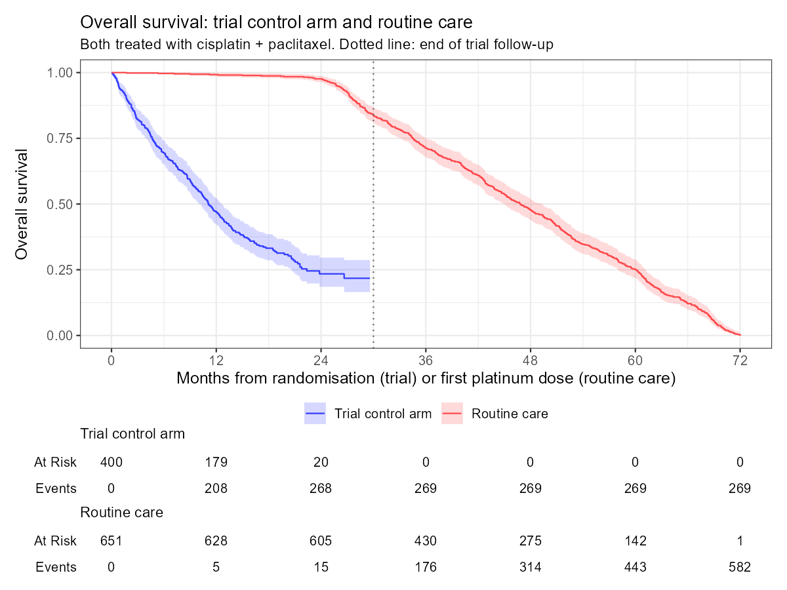

# Real-world cohort in the OMOP CDM

This folder holds the real-world part of the project: synthetic patient records (Synthea) converted to the OMOP Common Data Model, a cohort of treated cancer patients, and its survival compared with the simulated trial's control arm.

## Choosing the disease (pilot, 2026-10-26)

The analysis needs three things from the data: chemotherapy records, to define when follow-up starts; deaths, for overall survival; and enough patients in a general (not restricted) population. Synthea 3.3.0 has six cancer-related modules:

| Module | Decision | Reason |
|---|---|---|
| Lung cancer | Piloted | Chemotherapy, staging and deaths are modelled |
| Breast cancer | Piloted | Chemotherapy and deaths are modelled |
| Colorectal cancer | Not piloted in this round | Has chemotherapy (oxaliplatin, leucovorin) and deaths; could be compared later |
| Acute myeloid leukaemia | Excluded | No chemotherapy is modelled, so there is no treatment start to use as time zero |
| Veteran lung cancer | Excluded | Same model as lung cancer, but only for the simulated veteran population |
| Veteran prostate cancer | Excluded | Only for the simulated veteran population, and men only |

Two small Synthea 3.3.0 populations were generated, keeping only patients with the cancer diagnosis (`synthea/keep_lung.json`, `synthea/keep_breast.json`; commands in `synthea/run_pilots.sh`; seed 2026, ages 45–90). Counts were taken straight from the Synthea CSVs with `synthea/count_pilots.R`.

| | Lung | Breast |
|---|---|---|
| Patients | 204 (NSCLC 169, SCLC 35) | 134 |
| Treated with chemotherapy after diagnosis | 204 | 41 |
| Deaths within 30 months of first treatment | 39 | 9 |
| Patients with a second treatment course (> 90-day gap) | 14 | 0 |
| Drugs | cisplatin, etoposide, paclitaxel | epirubicin, doxorubicin, paclitaxel |

**Decision: lung cancer, non-small cell (NSCLC) only.** Every lung patient has treatment records, there are about four times as many deaths within 30 months, and only lung has second treatment courses. Small cell lung cancer is a different disease and is left out.

**Things to keep in mind**
- In Synthea, lung cancer patients live much longer than in reality: the median time from first treatment to death is about 45 months, while real advanced NSCLC has a median survival of about a year. Chemotherapy records also continue for years. These are features of the simulator, not findings. (The comparison with the trial below shows why: every patient in this population is stage I.)
- Synthea generates men and women equally, so many attempts to find a breast cancer patient failed (the "failed to produce a matching patient" messages in the breast log).
- `-p` in Synthea counts living patients only; deceased patients come on top.

## Full population

`synthea/run_full.sh` generates the lung cancer population with the same settings as the pilot (seed 2026, ages 45–90), asking for 120 living patients:

| | NSCLC | SCLC |
|---|---|---|
| Patients | 714 | 121 |
| Treated with chemotherapy after diagnosis | 713 | 121 |
| Deaths within 30 months of first treatment | 123 | 22 |

SCLC patients stay in the data and are excluded when the cohort is built.

## Source data profile (WhiteRabbit)

Before converting anything to OMOP, the Synthea CSVs were scanned with WhiteRabbit v1.0.0 (settings in `whiterabbit/scan.ini`). The scan report lists every table and column with its type, how often it is empty and its most common values. Values seen fewer than 5 times are left out of the report, and for large tables the frequencies come from the first 100,000 rows only.

What matters for the conversion:
- **Code systems are mixed.** Conditions are mostly SNOMED CT, but about 3% are ICD-10: mostly dental, but also 252 records of other cancers (mouth, throat, larynx…) in 174 patients, which matter for the cohort's "no other cancer" rule (see `etl/mapping_notes.md`). Procedures are SNOMED CT plus about 3% CDT (dental) codes; medications are RxNorm.
- **Two date formats.** Patients and conditions use plain dates (`2021-10-05`); encounters, medications and procedures use timestamps with a time zone (`2021-10-05T03:30:19Z`).
- **Death is recorded twice.** `DEATHDATE` is a column in `patients.csv` (filled for 748 of 835 patients), and each of these patients also has a *Death certification* encounter. ETL-Synthea builds the OMOP `death` table from the encounter, which is dated a few days later (see `etl/mapping_notes.md`).
- **Personal identifiers** (names, SSN, address, coordinates; all synthetic) are in `patients.csv`. They are not carried into OMOP.
- **Chemotherapy dominates the medication records:** cisplatin and paclitaxel are about 73% of the first 100,000 rows, because Synthea records them repeatedly for years. The OMOP `drug_exposure` table will be large.
- About 29% of conditions have no end date (ongoing conditions).

## Mapping to OMOP (Rabbit-in-a-Hat)

The conversion itself is done with ETL-Synthea, which already has a mapping for every table. Before running it, the tables the cohort needs were laid out in Rabbit-in-a-Hat on top of the WhiteRabbit scan, with the logic written down for each table and for every column that isn't a plain copy:

| File | What it is |
|---|---|
| `etl/synthea_to_omop.docx` | The mapping document: one section per OMOP table, with source columns and logic |
| `etl/synthea_to_omop.json.gz` | The Rabbit-in-a-Hat project (open with *File → Open ETL specs*) |
| `etl/mapping_notes.md` | What came up when checking the mapping against the data, where information is lost, and what it means for the cohort |

Tables mapped: `person`, `observation_period`, `visit_occurrence`, `condition_occurrence`, `drug_exposure`, `procedure_occurrence` and `death`.

## Vocabularies

The OMOP standard vocabularies were downloaded from [Athena](https://athena.ohdsi.org) (release v5.0 29-AUG-26, CDM v5 format): SNOMED, RxNorm, RxNorm Extension, ICD-10-CM, ICD-10, LOINC, CVX, OMOP Gender, Race, Ethnicity and OMOP Extension. Athena adds the small OMOP vocabularies (visit, domain, type concepts, UCUM units…) on its own. These cover every code system in the Synthea data except two:
- CPT4 needs a separate licence and Synthea doesn't use it.
- CDT (dental procedure codes, about 3% of procedures) isn't available from Athena, so those procedures are left out. The cohort doesn't use them.

## Loading into OMOP

`etl/load_omop.R` loads everything into PostgreSQL with ETL-Synthea (about 35 minutes, most of it the vocabulary). With PostgreSQL's default settings one step ran for 40 minutes without writing a row; the script now gives the ETL more memory and hash joins while it runs, and that step takes seconds.

| OMOP table | Rows |
|---|---|
| `person` | 835 |
| `observation_period` | 835 |
| `death` | 748 |
| `visit_occurrence` | 98,814 |
| `condition_occurrence` | 21,325 |
| `drug_exposure` | 437,892 |
| `procedure_occurrence` | 417,164 |
| `measurement` | 2,087,625 |
| `observation` | 501,006 |

Everything the cohort needs arrived: all 714 NSCLC patients, chemotherapy records for 834 patients, all 748 deaths, and the ICD-10-coded cancers mapped to SNOMED. Codes without a standard concept are left out rather than set to 0 (2% of conditions, mostly "history of…" findings, and the dental procedures); details in `etl/mapping_notes.md`.

## Data quality checks

`quality/run_quality.R` runs the two standard OHDSI checks on the loaded database (about 15 minutes):
- **Achilles** computes descriptive statistics for every table (people by age and sex, records per year, most frequent concepts) and stores them in the `results` schema.
- **DataQualityDashboard (DQD)** runs checks grouped into three questions: does the data follow the OMOP rules (*conformance*), are the fields filled (*completeness*), and are the values believable (*plausibility*). A check fails when more rows break it than its threshold allows.

The vocabulary tables come straight from Athena and are not checked, and neither are the cohort tables, which don't exist yet. That leaves 2,338 checks: **1,529 passed, 790 had nothing to check (an empty table or field) and 19 failed** (`quality/dqd_overview.csv`; the failed checks are in `quality/dqd_failed.csv`). None of the failures touches a field the cohort uses. They fall into three groups:

| Why it failed | Checks | Examples |
|---|---|---|
| Synthea doesn't record it, so the field is empty or 0 | 9 | Drug quantity and days of supply, units of measurements and observations, condition status, where a patient was admitted from or discharged to |
| The concept is in a vocabulary that wasn't downloaded, or is outdated | 5 | Currency in `cost`, provider specialty, the type concept ETL-Synthea uses for observations (replaced in newer vocabularies) |
| Odd values made by the simulator | 5 | Insurance periods running past death or far into the future, records starting before 1950 (Synthea simulates from birth), prescriptions lasting decades, one woman with a prostate cancer code |

What the cohort needs passed: person, condition and drug concepts, drug start dates, death dates and observation periods. Two extra checks on the fields that matter most: no death is recorded after the end of a person's observation period, so follow-up and death line up; and the chemotherapy records are cisplatin (834 patients), paclitaxel (714, the NSCLC patients) and etoposide (121, the SCLC patients).

**Things to keep in mind for the cohort**
- **Days of supply is 0 for every chemotherapy record.** Treatment start can be taken from the first drug date as planned, but how long a patient stays on treatment can't come from days of supply; it has to come from the gaps between drug dates.
- The woman with a prostate cancer code (ICD-10 C61, 1999) also has NSCLC. It's a simulator artefact. It would only matter if it fell in the five years before her treatment start, where the "no other cancer" rule would exclude her; it doesn't, so she stays in the cohort.

To browse all checks: `DataQualityDashboard::viewDqDashboard("M:/Data/omop/quality/dqd_results.json")`.

## The cohort: NSCLC patients starting platinum chemotherapy

The trial's control arm is first-line cisplatin + paclitaxel. Its real-world counterpart is defined in `cohort/nsclc_platinum.sql` and built by `cohort/build_cohort.R`. The SQL is written in OHDSI SQL and translated with SqlRender, so it runs on any database the OMOP tools support. Every concept is used with all its descendants in the vocabulary.

**Index date** (start of follow-up): the first ever dose of platinum chemotherapy (cisplatin or carboplatin). It plays the role of randomisation in the trial.

**Inclusion rules**, applied in this order (`cohort/attrition.csv`):

| Rule | Why | Patients left | Removed |
|---|---|---|---|
| First platinum dose | Entry event | 834 | |
| NSCLC diagnosed in the 180 days before the first dose | The chemotherapy is the first treatment for this cancer (first line) | 713 | 121 (the SCLC patients) |
| Never diagnosed with small cell lung cancer | A different disease with a different prognosis | 713 | 0 |
| Paclitaxel within 7 days of the first dose | Same regimen as the trial's control arm | 713 | 0 |
| No other cancer in the previous 5 years (basal and squamous cell skin cancers allowed) | Usual trial exclusion; another cancer would change survival | 651 | 62 (mostly prostate and head and neck cancers) |
| Aged 18 or over | Trial eligibility | 651 | 0 |
| At least a year of records before the first dose | So the look-back rules have data to look at | 651 | 0 |

Three rules remove nobody here, because Synthea treats every NSCLC patient the same way and simulates everyone from birth. They stay in the definition because in real data they would remove patients.

Follow-up runs from the first dose to death, or to the end of the patient's records (the end of the observation period), where alive patients are censored. The cohort is stored in the standard OMOP `results.cohort` table (cohort_definition_id 1), so other OHDSI tools can use it.

**Cross-check with the OHDSI cohort tools.** `cohort/crosscheck_circe.R` builds the same cohort a second, independent way. The definition is written in R with `Capr` (installed from github.com/OHDSI/Capr) and exported as Circe JSON (`cohort/nsclc_platinum.json`, the format ATLAS uses, so it can be imported into ATLAS as it is). `CirceR` turns the JSON into SQL and `CohortGenerator` runs it. One difference in structure: Circe checks the year of prior records at entry, so that rule is part of the entry event instead of the list of rules.

| | SQL cohort | Circe cohort |
|---|---|---|
| Patients | 651 | 651 |
| Attrition (after each rule) | 834 → 713 → 713 → 713 → 651 → 651 | 834 → 713 → 713 → 713 → 651 → 651 |
| Only in one of the two | 0 | 0 |
| Same patient, different start or end date | 0 | 0 |

The two definitions agree patient by patient (`cohort/crosscheck.csv`, `cohort/attrition_circe.csv`).

**Who is in it** (`cohort/cohort_summary.csv`):

| | Cohort | Trial control arm (showcase trial, `trial/results/showcase`) |
|---|---|---|
| Patients | 651 | 400 |
| Age, median | 56 (IQR 51–64) | 64 |
| Aged 65 or over | 22% | 48% |
| Male | 48% | 62% |
| Deaths | 583 (90%) | |
| Follow-up, median | 44 months (0.2–72) | |

**Limits of this data compared with the trial**
- **Every patient has stage I disease; the trial enrols stage IV.** Synthea records the stage inside the diagnosis code, but the OMOP mapping drops it (see below), so it can only be read from the source value. A stage rule would leave nobody, so the cohort keeps everyone and the stage is reported instead.
- **No performance status (ECOG), histology or biomarker.** Synthea doesn't record them, so the trial's other prognostic factors can't be compared. Only age and sex can.
- **Everyone also has chemoradiation.** All patients have *Combined chemotherapy and radiation therapy* records, which doesn't match first-line chemotherapy for advanced NSCLC either.
- **First doses from 1983 to 2026.** Treatment standards changed over that time; since about 2018, first-line advanced NSCLC usually gets immunotherapy with or without chemotherapy, not chemotherapy alone. Synthea doesn't model this, so no calendar restriction is applied.
- **Patients are younger than in the trial and survive much longer than in reality**, as the next section shows.

## Overall survival compared with the trial's control arm

`analysis/compare_os.R` turns the cohort into ADSL and ADTTE with `admiral`, using the same event and censoring rules as the trial (death is the event; patients still alive are censored at the last date known alive, here the end of their records). The first platinum dose takes the place of randomisation. It then puts the cohort next to the control arm of the showcase trial (`trial/results/showcase/adtte_os.csv`, 400 patients) and summarises both with the same `tern` tables. Output in `results/`.

| | Trial control arm | Routine care |
|---|---|---|
| Patients | 400 | 651 |
| Stage | IV (trial eligibility) | I (all) |
| Deaths | 269 (67%) | 583 (90%) |
| Median OS (95% CI) | 11.1 months (10.0–12.5) | 46.8 months (44.9–49.0) |
| Alive at 12 months | 47% | 99% |
| Alive at 24 months | 23% | 98% |
| HR routine care vs trial, first 30 months | | 0.04 (0.03–0.06) |
| Same, adjusted for age group and sex | | 0.04 (0.03–0.06) |

The trial follows patients for 30 months and the cohort for up to 6 years, so for the hazard ratio both are cut at 30 months.

**What this means**
- The routine-care patients are not comparable with the trial's control arm, and age and sex aren't the reason: adjusting for them doesn't move the HR at all.
- **Stage explains it.** In Synthea 3.3.0, an undiagnosed lung cancer patient has a 20% chance each month of symptoms that lead to diagnosis, and anyone diagnosed within 36 months is stage I. Practically nobody reaches stage II-IV (all 713 treated NSCLC and all 121 SCLC patients here are stage I). For stage I the module sets death 2 to 6 years after diagnosis, a median of 4 years, which is the 46.8 months seen here. Almost no one dies in the first two years, then deaths come at a steady rate until 6 years.
- **Without the source value the stage would have been invisible.** The OMOP vocabulary maps "Non-small cell carcinoma of lung, TNM stage 1" to "Non-small cell lung cancer". In OMOP, stage belongs in the Cancer Modifier vocabulary and the oncology extension, which weren't part of this conversion.
- An HR of 0.04 would be absurd as a treatment comparison; here it is a measure of how different the two populations are. This is the reason external comparisons need a check of comparability on the main prognostic factors first.

**Further checks** (`analysis/compare_os.R`, `analysis/characterise_cohort.R`):
- **A single HR is not a fair summary here.** The proportional hazards test (`cox.zph`, first 30 months, adjusted for age group and sex) gives p = 1.7 × 10⁻⁷ for the source (`results/ph_test.csv`): the routine-care patients hardly die for two years and then die steadily, the trial's die from the start. The KM curves, not the HR, show how the groups differ.
- **Age doesn't explain the gap.** Median OS is 11.1 vs 11.0 months for patients under and over 65 in the trial, and 47.6 vs 44.7 months in routine care (`results/median_os_by_age.csv`, `results/f_km_os_by_age.png`).
- **The cohort's medical history doesn't look like lung cancer patients' either.** FeatureExtraction, the OHDSI tool for describing a cohort, summarises the year before the first dose (`results/table1_cohort.csv`, `results/top_conditions_prior_year.csv`). COPD is recorded in 0.3% of patients, although most real NSCLC patients are (former) smokers and COPD is common among them; the most frequent recent diagnoses are dental (tooth disorders 61%, caries 54%), from Synthea's dental model. The median Charlson comorbidity index is 3. A few patients have an older cancer (prostate, breast, colon) still recorded as ongoing: diagnosed more than five years before, so the cohort rule keeps them.

**How stage would be stored with the OMOP oncology extension.** OMOP CDM v5.4 has what this conversion was missing. Stage, grade and TNM categories are concepts in the Cancer Modifier vocabulary and are stored as rows in `measurement`, linked to the diagnosis they describe through `measurement_event_id` (the `condition_occurrence_id` of the NSCLC diagnosis) and `meas_event_field_concept_id`. The `episode` and `episode_event` tables group records into disease episodes (first occurrence, progression) and treatment episodes (lines of therapy). With Synthea's stage codes loaded this way, the cohort could have required stage IV directly in its definition, and the trial comparison would have been run on comparable patients from the start. Here it would leave nobody, since every patient is stage I.

**What a valid comparison with real data would need:** stage and ECOG captured at the start of treatment (OMOP oncology extension or registry data), the trial's eligibility criteria applied to them, a calendar window when chemotherapy alone was the standard first-line treatment, and adjustment or weighting for the remaining differences in age, sex and other prognostic factors.

## Borrowing the cohort as external controls

`analysis/hybrid_control.R` asks whether the cohort could supplement the trial's control arm (a hybrid control arm), using Bayesian dynamic borrowing with `psborrow2`. External follow-up is cut at 30 months like the trial's, and OS is modelled as exponential, adjusted for age group and sex (`results/hybrid_control.csv`, `results/f_hybrid_control.png`).

Taking the cohort as if it were trial patients (full borrowing) turns the trial's HR for Drug X from 0.71 into 2.40, because the "controls" now live far longer. The commensurate prior detects the disagreement, borrows almost nothing and gives back the trial-only answer. As a positive check, the control arm of a second simulated trial with the same design is borrowed from, narrowing the interval. Results and interpretation are in the main README.

Stan models are compiled by CmdStan (`cmdstanr::install_cmdstan()`), which on Windows needs Rtools. Here Rtools is in `M:/Tools/rtools44` and CmdStan in `M:/Tools/cmdstan`, set with `RTOOLS44_HOME` and `CMDSTAN` in the project's `.Renviron`.

## Data location
Synthea output is written to `M:/Data/synthea/`, the vocabularies to `M:/Data/vocab/` and the full data quality output to `M:/Data/omop/quality/`. None of it is tracked in git: the Synthea data can be regenerated with the commands in `synthea/`, and the vocabularies downloaded again from Athena with the list above.
